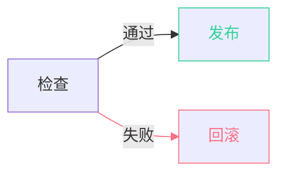

# mermaid-text

把一幅 Mermaid 图渲染为终端字符，也可将支持的图种直接显示为图片或导出为 PNG。输入是 UTF-8 图源码，省略 Markdown 的三反引号围栏。`dots install` 在 Linux 和 macOS 上把本仓库的程序安装到 `~/.local/bin/mermaid-text`。

```sh
mermaid-text --example | less -RS
mermaid-text --example flowchart --border-corners rounded
mermaid-text --example C4Context C4Container C4Component
printf 'flowchart LR\n A[读取] --> B[解析] --> C[显示]\n' | mermaid-text
mermaid-text --width 100 diagram.mmd
mermaid-text --ascii diagram.mmd
mermaid-text --border-corners rounded diagram.mmd
mermaid-text --list-types
```

`--width` 指定目标显示列数，默认为 80，可取 1–4096。流程图按节点和连线标签的实际列宽排版：宽窗会拉开分支，窄窗会收紧间距，单线流程保持紧凑。图的最小布局超出目标时，需要横向浏览。`--ascii` 切换绘图符号；节点名、消息和其他用户文字保留 Unicode。Nerd Font 图标的外观取决于终端字体。

普通模式成功时向 stdout 输出整幅图，失败时向 stderr 输出诊断并以非零状态退出。单幅图的输入上限是 256 KiB。

`--border-corners` 设置矩形框四角。`auto`（默认）沿用各图种的形状，`square` 使用 `┌┐└┘`，`rounded` 使用 `╭╮╰╯`。也可按左上、右上、左下、右下传入四个各占一列的字符，例如 `--border-corners '▛▜▙▟'`。环境变量 `MERMAID_TEXT_BORDER_CORNERS` 可设置 CLI 默认值，命令行参数优先。`--ascii` 始终使用 ASCII 绘图符号。

`--example` 展示所有内置[示例源码]的渲染结果。可从 `--list-types` 选择一个或多个名称，按输入顺序展示；别名共用同一份示例。比如 `--example sequenceDiagram` 演示锁座、查单、出票与释放座位；`--example C4Dynamic C4Deployment` 从支付回调的调用顺序切换到票务系统的主站与灾备部署。示例随二进制分发，可在任意目录运行。

## 在终端显示图片或导出 PNG

```sh
mermaid-text --kitty-image --example gantt gitGraph sankey-beta
mermaid-text --kitty-image diagram.mmd
mermaid-text --png --image-width 1200 --example xychart > reservoir.png
mermaid-text --png --image-width 1280 --image-height 720 diagram.mmd > slide.png
mermaid-text --png --list-types
```

`--kitty-image` 在 Kitty 中直接显示图片，`--kitty-image --example` 依次显示内置示例。使用 tmux、screen 或输出重定向时，选 `--png`。

两种图片输出默认探测终端的可用像素，预留一行给提示符，图形等比适配。PNG 重定向到文件时，仍会从连接的终端取得尺寸。终端只报告行列数时按每格 8 × 16 像素估算；无终端时使用图的自然尺寸，超过 PNG 上限时等比缩小。`--width` 以列为单位，可限制终端中的显示宽度。

`--image-width` 和 `--image-height` 以像素为单位。只设一项时，另一项按图的宽高比计算；同时设置时，图片尺寸精确匹配，图形等比居中，空余部分使用画布底色。Kitty 会将超出窗口的图片缩小显示。

`--png` 从 stdout 写出一张 PNG。诊断写到 stderr，失败时退出码非零。图种及别名见 `--png --list-types`。标签使用系统字体排版；要显示中文或 Nerd Font 图标，本机需安装包含相应字形的字体。`--no-color` 和非空的 `NO_COLOR` 可生成单色图。`--stream` 提供字符图的 JSONL；图片消费者在源码写完后提交整幅图。

彩色 PNG 默认使用深灰画布。要透出终端或编辑器底色，在 `config.themeVariables` 中设 `background: transparent`；节点 `fill` 和时序图 `rect rgba(...)` 的透明度也会保留。单色 PNG 使用白底和灰阶。图片宽高各限 8192 像素，总面积限 16,777,216 像素。

流程图的连线会绕开节点；过密的布局可能有交叉，无法布线时会返回诊断。时序图支持参与者图形、消息、激活区间和嵌套分支；参与者的链接和详情在图片下方展示为文本。半箭头目前会返回诊断。

## 在 Pi 阅读

Pi 的 [Mermaid 扩展]在 assistant 回复的顶层 `mermaid` 围栏中显示字符图。将 Pi 的 `markdown.mermaid` 设为 `"off"`，让围栏交给扩展处理。源码逐行生成时，预览保留最近一次成功的图；围栏闭合后若渲染失败，会显示源码和诊断。

标题栏的 `source` / `rendered` 切换源码和字符图，`copy` 复制当前视图，`hide` / `show` 折叠或展开。新到的图帧保留你选的视图。用 `/copy` 选中该块时，复制的始终是字符图的纯文本，保留空格和换行；尚未出图或渲染失败时复制源码。

需要图片时，Pi 的 `python_repl` 可以从管道取得 PNG，调用 `display_image` 在工具结果里显示。终端需支持图片，Pi 设置 `terminal.showImages` 需开启：

```python
import subprocess

source = "flowchart LR\n A[读取] --> B[显示]\n"
png = subprocess.run(
    ["mermaid-text", "--png"], input=source.encode(), capture_output=True, check=True
).stdout
display_image(png)
```

## 颜色

在 Mermaid 源码中指定颜色，CLI 默认输出 24-bit ANSI 颜色，重定向和管道同样生效。没有配色的图沿用终端原色。`--no-color` 或非空环境变量 `NO_COLOR` 关闭颜色；`--ascii` 可与颜色独立使用。



内置示例用前景色区分数据，保留终端底色。例如[饼图扇区]和[XY 图的系列色]可直接在 `config.themeVariables` 中指定。`theme: base` 等命名主题自带画布底色；只想设置系列色时可以省略 `theme`。

流程图的 `stroke` 设置边框或线条色，`color` 设置文字色，`fill` 设置节点底色。同一节点上，直接 `style` 按属性覆盖 class 配色。全图的 `textColor` 和 `background` 可写在 YAML frontmatter 的 `config.themeVariables` 中。终端使用 RGB；半透明色无法精确复现浏览器的透明度混合。

## 在 Neovim 阅读

打开包含 `mermaid` 围栏的 Markdown 文件。光标离开围栏时显示字符图，移入时可以编辑源码。`<leader>um` 随整页 Markdown 切换渲染。宽图先显示当前窗口能容纳的部分；把光标移到围栏内，执行 `:MermaidView`，在不换行的只读分屏中横向浏览完整输出。语法错误也可以用这个命令查看。

光标在围栏内时，执行 `:MermaidImage` 可用 Snacks 预览当前源码生成的 PNG。

[Neovim 显示设置]中的 `border_corners` 默认为 `"rounded"`，取值与 CLI 相同，设为 `nil` 时沿用 CLI 默认值。`source = "cursor"` 随光标切换；`source = "below"` 在阅读时同时保留图下方的源码。`ascii` 切换绘图符号；`max_width` 限制排版宽度。窗口可用列数分别计算，同一个文件在大小不同的分屏里可以有不同的排版。

内联预览和 `:MermaidView` 使用 Neovim 原生高亮显示源码中的颜色。将 `color` 设为 `false` 可以只关闭 Neovim 里的图表颜色。

## 图种与兼容范围

`--list-types` 列出当前接受的首行标识。支持的图包括流程图、时序图、状态图、类图、ER、架构图、C4、甘特图、Git 分支图、数据包、曲线和柱状图、象限图、雷达图、面积树图、桑基图、时序事件时间线，以及使用不同文法的铁路图。

图形以终端列宽布局。支持 UTF-8 BOM、CRLF、整行 `%%` 注释和 YAML frontmatter 的 `title`。`config.gitGraph.mainBranchName` 可指定 Git 图的初始分支名，`config.packet.bitsPerRow` 可指定数据包每行的位数，默认 32。可在 `config.theme` 中显式选择 `base`、`default`、`dark`、`forest` 或 `neutral`；`themeVariables` 可覆盖主题颜色。各图种支持的样式与语句见[图种入口]，复杂 HTML 标签等未支持的语法会返回诊断。

## 接入流式文本

启动 `mermaid-text --stream --width 80`，向 stdin 追加同一幅图的源码，将 stdout 解析为逐行 JSON。写完一个围栏的内容后关闭 stdin。`frame.lines` 是可以直接显示的行数组，每帧完整替换上一帧。

| `type` | 消费者行为 |
| --- | --- |
| `frame` | 显示 `lines`。同一批输入里的多行可以合并为一帧。 |
| `done` | 最终源码渲染成功，保留最后一帧。 |
| `error` | 呈现 `message`；已显示的预览只对应较早的输入。 |

`frame.lines` 始终是纯文本。有颜色的帧额外提供 `styles` 数组：每项的 `row` 从 0 开始，`start`、`end` 是该行 UTF-8 字节区间 `[start, end)`；`fg`、`bg` 为 `#rrggbb`，`null` 表示沿用默认颜色。

程序在收到完整源码行后尝试渲染并刷新 stdout。UTF-8 字符可以跨输入块，尚未闭合的语句不会清空上一张图。EOF 提交最后一行并校验整幅图，末行可以没有换行符。调用方需要同时读取 stdout，避免长图写满管道后阻塞。

`--stream --example` 每完成一幅图就输出一帧，帧中包含已展示的全部示例，最后输出一次 `done`。

## 新增图种

在 `src/charts/<图种>/mod.rs` 实现 [Chart] 的 `render_text`，并在[图种入口]登记主名称和别名。`examples/<主名称>.mmd` 同时供 `--example` 和示例集使用。图种支持图片时，将 `IMAGE` 设为绘制到 `Scene` 的函数；`--png` 和 `--kitty-image` 共用这幅图。跨图种复用的模型、解析和布局放在 `src/charts/shared/`。

[Neovim 显示设置]: ../../../tree/home/.config/nvim/lua/utils/markdown_mermaid.lua#L1
[Mermaid 扩展]: ../../../pi/src/extensions/tui/mermaid/index.ts
[图种入口]: src/charts/catalog.rs#L1
[Chart]: src/charts/mod.rs
[示例源码]: examples/
[饼图扇区]: examples/pie.mmd
[XY 图的系列色]: examples/xychart-beta.mmd
