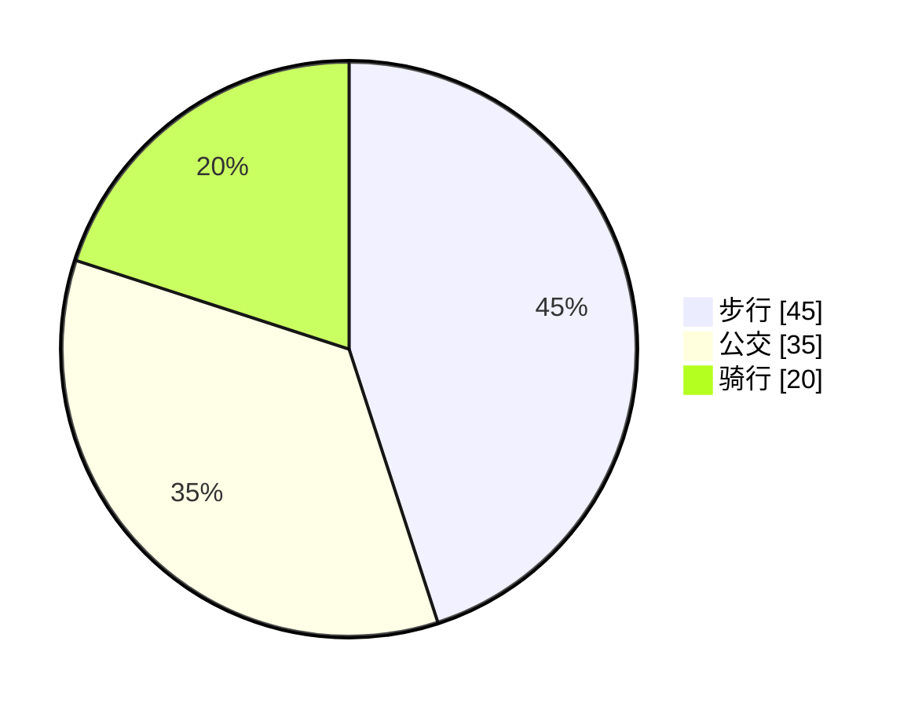
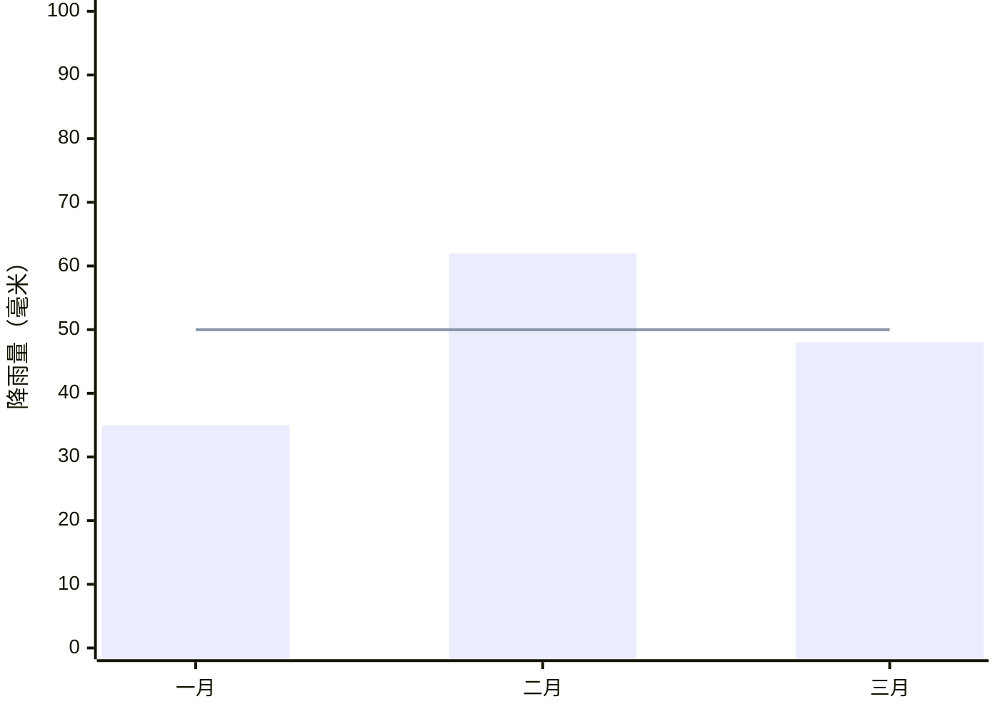
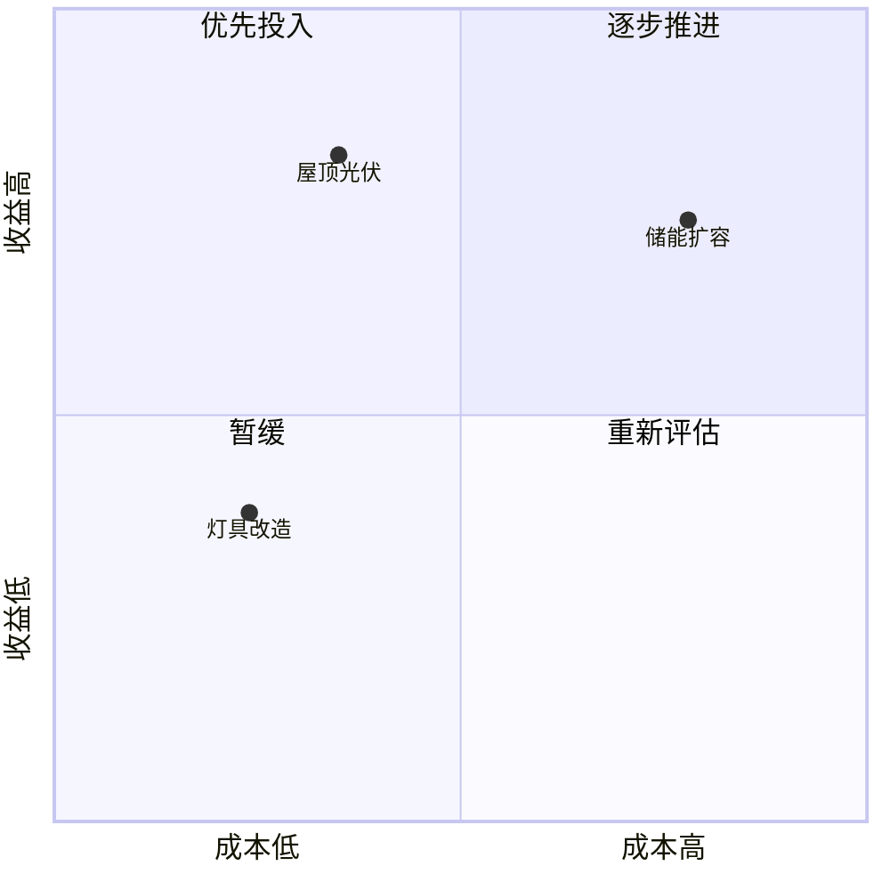
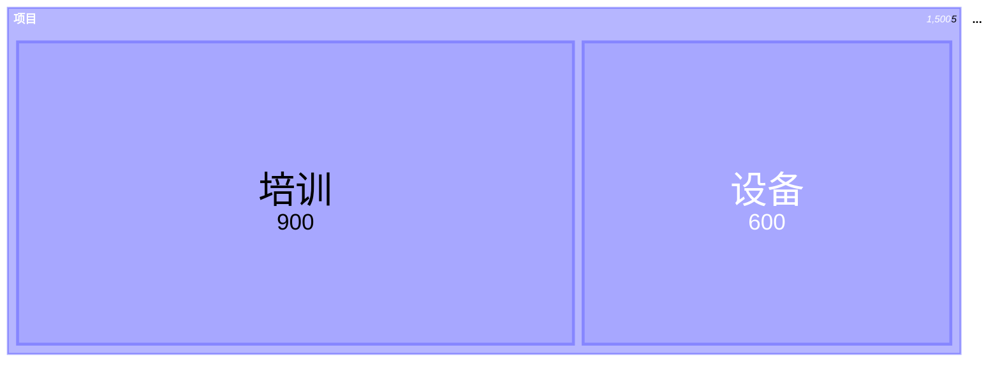
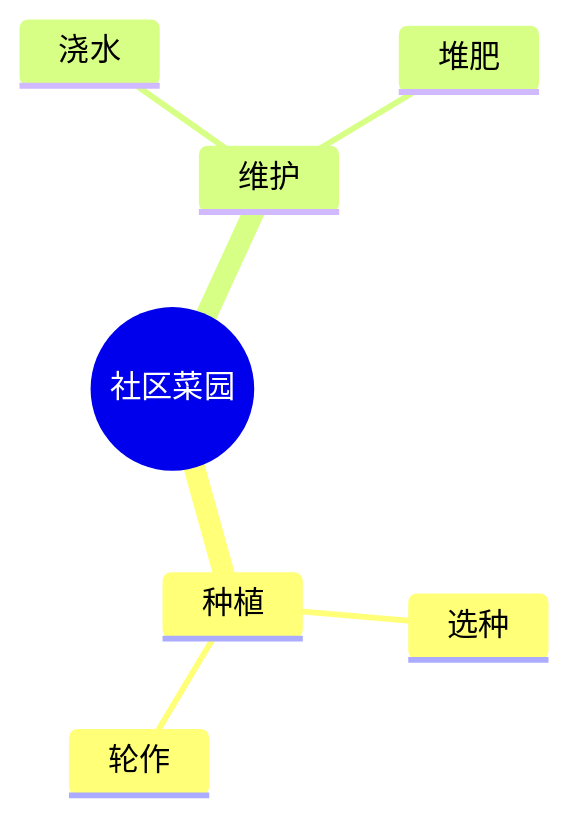
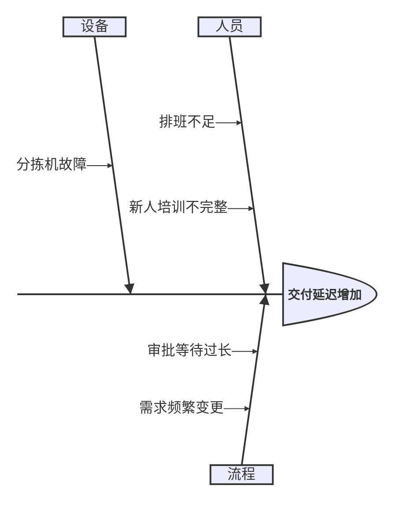

## pie

用 `pie` 开始，后续每行以 `"类别": 数值` 声明扇区；`showData` 会在图例中显示数值。



## xychart-beta

`x-axis` 列出离散类别，`y-axis` 可用 `最小值 --> 最大值` 指定数值范围；`bar` 和 `line` 的数据项数量应与横轴类别对应。



## quadrantChart

用 `x-axis`、`y-axis` 设置轴端标签，`quadrant-1` 到 `quadrant-4` 设置象限名称；数据点坐标是 0 到 1 之间的 `[x, y]`。



## radar-beta

`axis` 用逗号分隔维度，`max`、`min` 设置数值范围，`ticks` 设置刻度数；每条 `curve` 的花括号数值按轴顺序填写。


## sankey-beta

每行按「来源, 去向, 数值」声明一条流，数值表示流量，单位由图表数据自行约定；同名来源或去向会汇入同一节点。

```mermaid
sankey-beta
太阳能,电网,70
太阳能,储能,30
风能,电网,60
储能,电网,20
电网,住户,120
电网,工厂,30
```

## treemap-beta

每个顶层名称声明一个分组，缩进的子项以 `名称: 数值` 给出面积权重；数值可用下划线分隔千位。



## venn-beta

用 `set 名称 [标签]: 数值` 声明集合，`union 集合,集合 [标签]: 数值` 标注重叠区域；`text 集合,集合 文字 [标签]` 可在交集处添加说明。

```mermaid
venn-beta
set 公交 [公交乘客]: 40
set 地铁 [地铁乘客]: 50
union 公交,地铁 [两者皆用]: 18
text 公交,地铁 换乘通勤者 [常换乘]
```

## mindmap

根节点可写成 `标识((文字))`，后续节点通过逐级缩进表示父子层级；节点内容可直接使用中文。



## treeView-beta

用缩进声明树形层级；节点文字可用双引号包裹，并以 `##` 添加描述。


## ishikawa-beta

首行写待分析的问题，后续缩进列出原因类别及其子因；继续增加缩进即可细分原因。



## wardley-beta

以 `anchor` 和 `component` 按 `[可见性, 演进度]` 放置节点，坐标范围为 0 到 1；`evolution` 定义演进阶段，箭头表示依赖关系。


## cynefin-beta

用 `clear`、`complicated`、`complex`、`chaotic`、`confusion` 声明领域及其中事项；`-->` 可描述事项在领域间的转移，并在冒号后附加说明。

```mermaid
cynefin-beta
  clear
    "按计划补货"
  complicated
    "评估新仓库"
  complex
    "试行社区配送"
  chaotic
    "先处理断电"
  confusion
    "缺货原因待查"
  confusion --> complicated : "核对库存记录"
  chaotic --> complex : "恢复供电"
```
