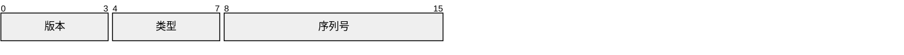

## packet-beta

用连续的位编号描述数据包字段，范围写作 `起始-结束`，也可用 `+位数` 从前一字段后接续；每行字段名必须是双引号字符串，且字段范围必须无间断。适合展示协议字段的位宽与布局。



## info

卡片自动显示当前 `mermaid-text` 版本，`showInfo` 加上渲染器名称。用 `title:` 命名卡片，`accDescr:` 补充说明。


## railroad-beta

规则写作 `名称 = 表达式;`。用 `terminal` 写字面量，`nonterminal` 引用规则，再用 `sequence`、`choice`、`optional`、`zeroOrMore` 或 `oneOrMore` 表达顺序、选择和重复。

```mermaid
railroad-beta
request = sequence(terminal("GET "), nonterminal("path"), optional(terminal("?query")));
path = oneOrMore(terminal("/segment"));
```

## railroad-abnf-beta

使用 ABNF 规则语法：规则以 `=` 定义并以分号结束，`/` 表示选择，`[]` 表示可选，重复次数及 `%x` 数值终结符可用于规则表达式。规则名限 ASCII 字母开头，字面量使用双引号；增量定义 `=/` 不受支持。

```mermaid
railroad-abnf-beta
request = method SP path ;
method = "GET" / "POST" ;
SP = %x20 ;
path = 1*ALPHA ;
ALPHA = %x41-5A / %x61-7A ;
```

## railroad-ebnf-beta

使用 EBNF：规则用 `::=` 定义并以分号结束，`|` 表示选择，逗号连接序列，`[]` 表示可选，`{}` 表示重复；注释可写作 `(* ... *)` 或 `/* ... */`。适合遵循 EBNF 运算符习惯的语法描述。

```mermaid
railroad-ebnf-beta
request ::= method , " " , path ;
method ::= "GET" | "POST" ;
path ::= "/" , { letter } ;
letter ::= "a" | "b" | "c" ;
```

## railroad-peg-beta

使用 PEG：规则以 `<-` 定义并以分号结束，`/` 是有序选择，`&` 和 `!` 分别为正向与否定前瞻，`*`、`+`、`?` 表示重复或可选，`.` 匹配任意字符。选择 PEG 可明确依赖有序匹配与前瞻的语法。

```mermaid
railroad-peg-beta
Word <- (!Space .)+ ;
Space <- " " ;
```
