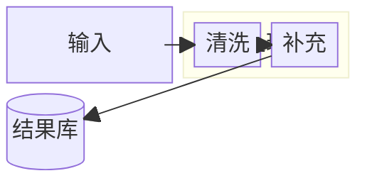
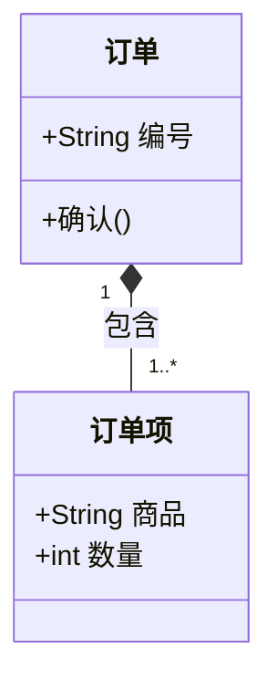
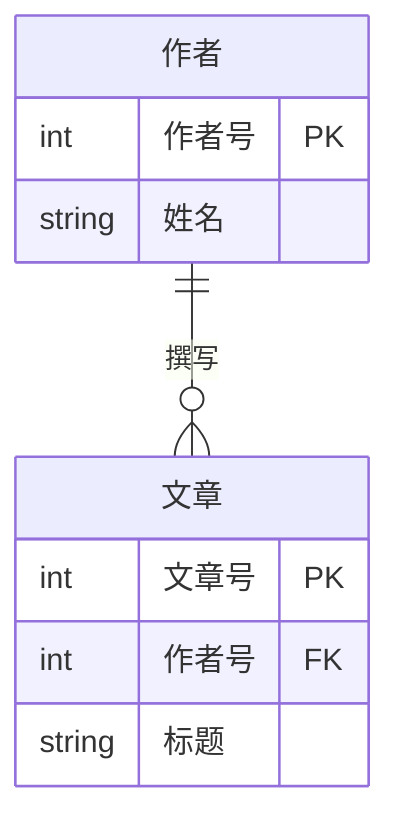
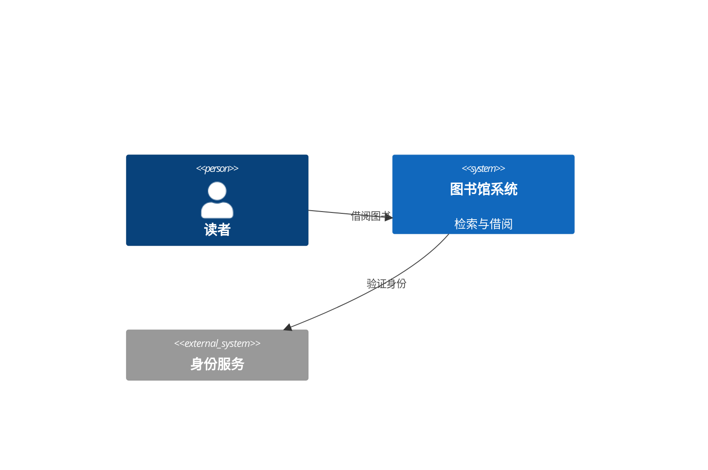
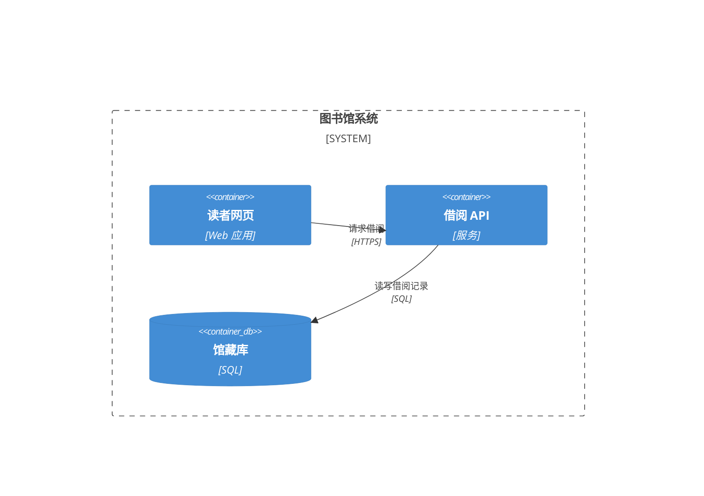
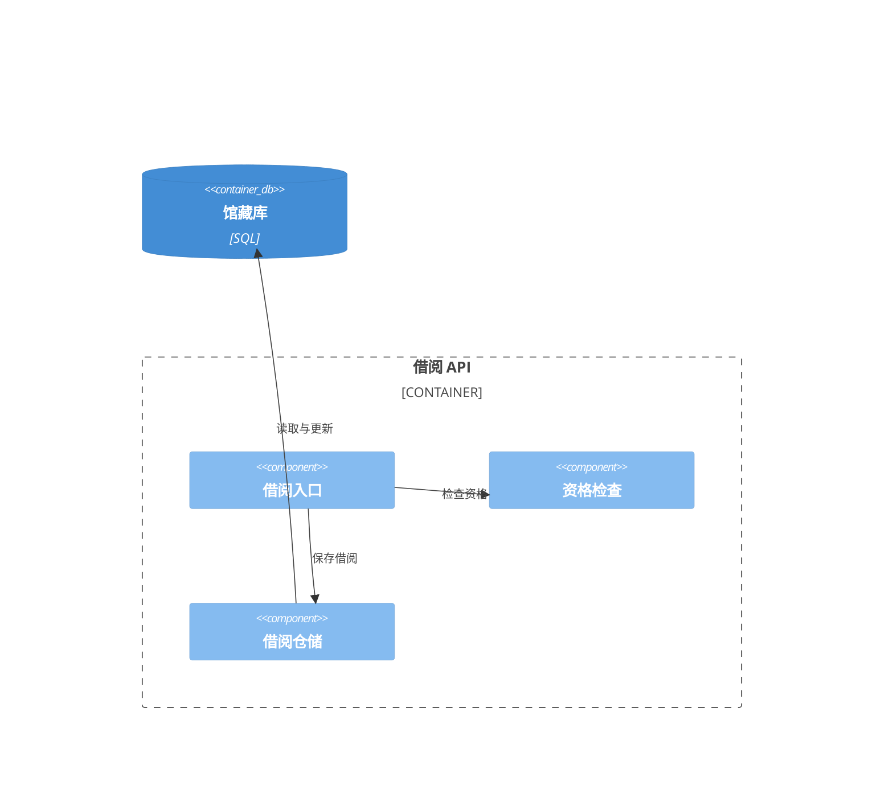
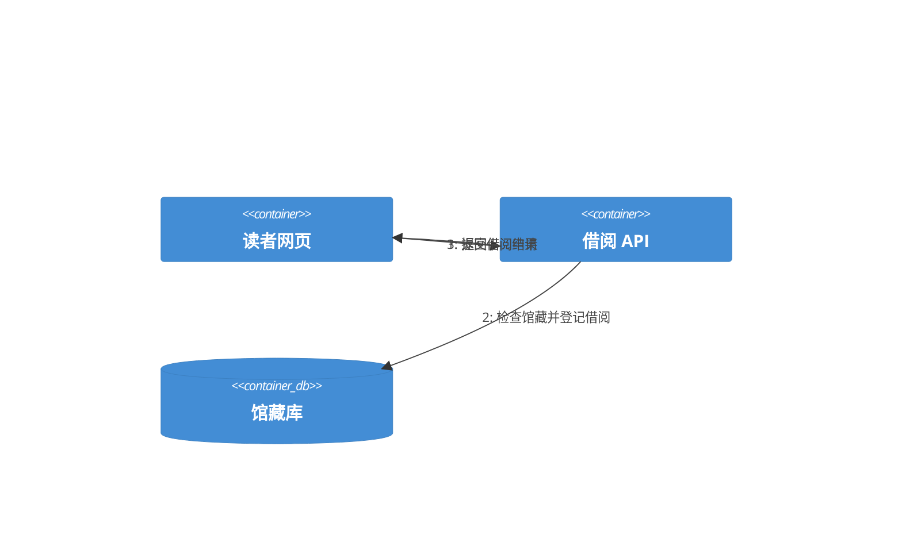
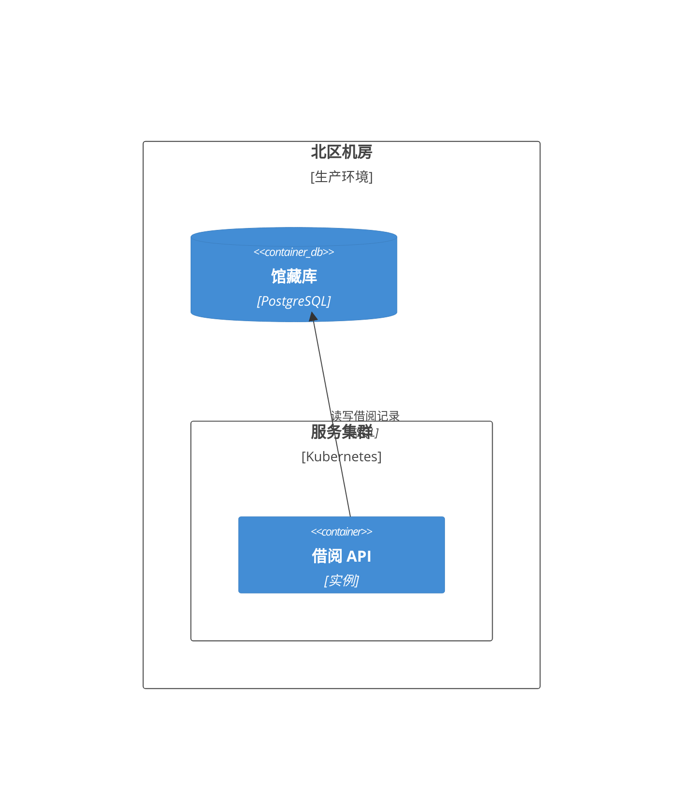

## architecture-beta

用 `group` 划分架构边界，用 `service` 声明服务或资源；节点可写图标类型与标签，并用 `in` 放入分组。连线可指定端口（`L`、`R`、`T`、`B`）、方向和关系标签。


## block-beta

用 `columns` 设置网格列数，节点可通过 `:宽度` 占用多列，也可用 `block:名称["标题"]` 与 `end` 嵌套分组。连接符支持有向、无向及虚线，并可添加关系标签。



## classDiagram

用 `class` 声明类，并在花括号内列出属性和方法；成员前可用 `+`、`-`、`#` 标记可见性。类之间可表达继承、组合、依赖等关系，并在连线上标注多重性与角色。



## erDiagram

实体用花括号列出字段，字段可标注 `PK`、`FK`、`UK`；关系端点用 `||`、`o|`、`|{`、`o{` 表示基数与可选性。关系连线可用实线或虚线，并附上关系名称。



## usecase-beta

用 `actor` 声明参与者、`systemBoundary` 与 `end` 划出系统边界，并在边界内列出用例。参与者用无向线关联用例；`..> : include` 表示必含用例，`..> : extend` 表示扩展用例。

```mermaid
usecase-beta
    actor Reader("读者")
    systemBoundary "图书馆系统"
        Search("检索馆藏")
        Borrow("借阅图书")
        Check("检查借阅资格")
    end
    Reader -- Search
    Reader -- Borrow
    Borrow ..> : include Check
```

## requirementDiagram

用 `requirement`、`designConstraint`、`interfaceRequirement` 等类型声明需求块，填写 `id`、`text`、`risk` 与 `verifymethod`；也可用 `element` 表示满足或验证需求的设计项、测试项。关系以 `源 - 关系 -> 目标` 表示，常用关系包括 `satisfies`、`verifies`、`refines` 和 `contains`。

```mermaid
requirementDiagram
    requirement "备份可恢复" {
        id: BK-01
        text: "故障后 30 分钟内恢复数据"
        risk: high
        verifymethod: test
    }
    element "恢复演练" {
        type: "验收用例"
    }
    "恢复演练" - verifies -> "备份可恢复"
```

## C4Context

展示系统边界及其与用户、外部系统的关系，适合说明系统在业务环境中的位置。用 `Person`、`System`、`System_Ext` 声明人物与系统，再用 `Rel` 或 `BiRel` 描述交互。



## C4Container

展开一个系统，展示其可独立运行或存储数据的容器、技术选型及容器间通信；用 `System_Boundary` 包含系统内部容器。常见声明包括 `Container`、`ContainerDb` 和 `ContainerQueue`。



## C4Component

展开单个容器，展示其内部组件、职责及组件间关系；用 `Container_Boundary` 框出目标容器，`Component` 声明组件。图中可同时保留组件依赖的外部容器或系统，呈现组件与边界外资源的连接。



## C4Dynamic

用 `RelIndex(编号, 来源, 目标, 描述)` 标出一次业务场景的交互顺序。参与者、系统和容器均可作为交互端点。



## C4Deployment

展示软件运行时实例与部署环境的对应关系，使用可嵌套的 `Deployment_Node` 表示区域、主机或运行平台，并在其中放置容器及数据存储。用普通关系连线标注流量路径、连接或复制关系。


