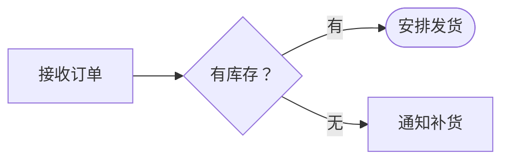
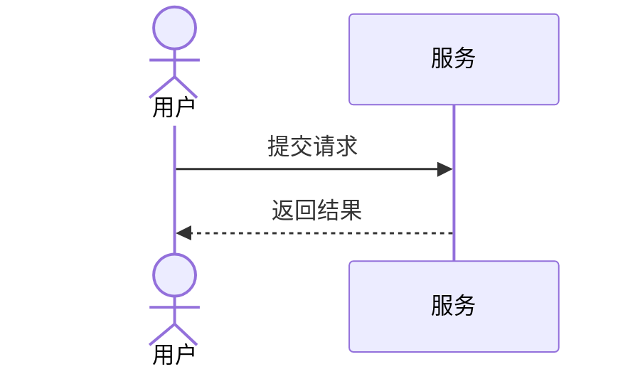
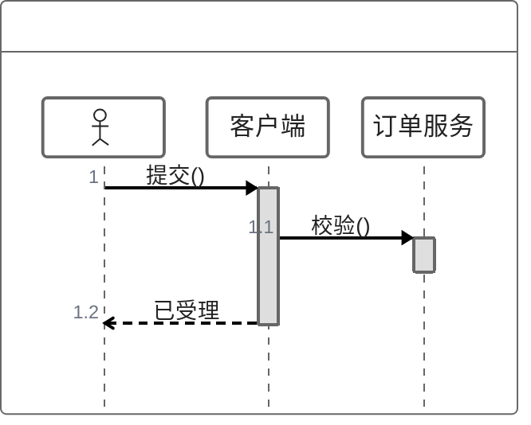
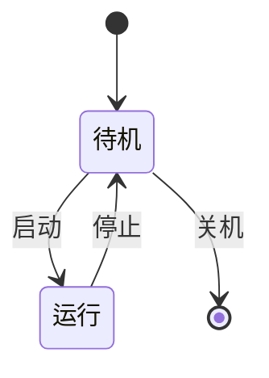
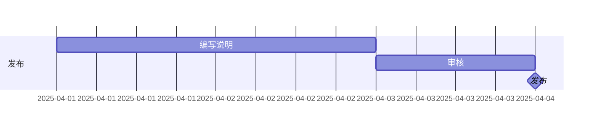
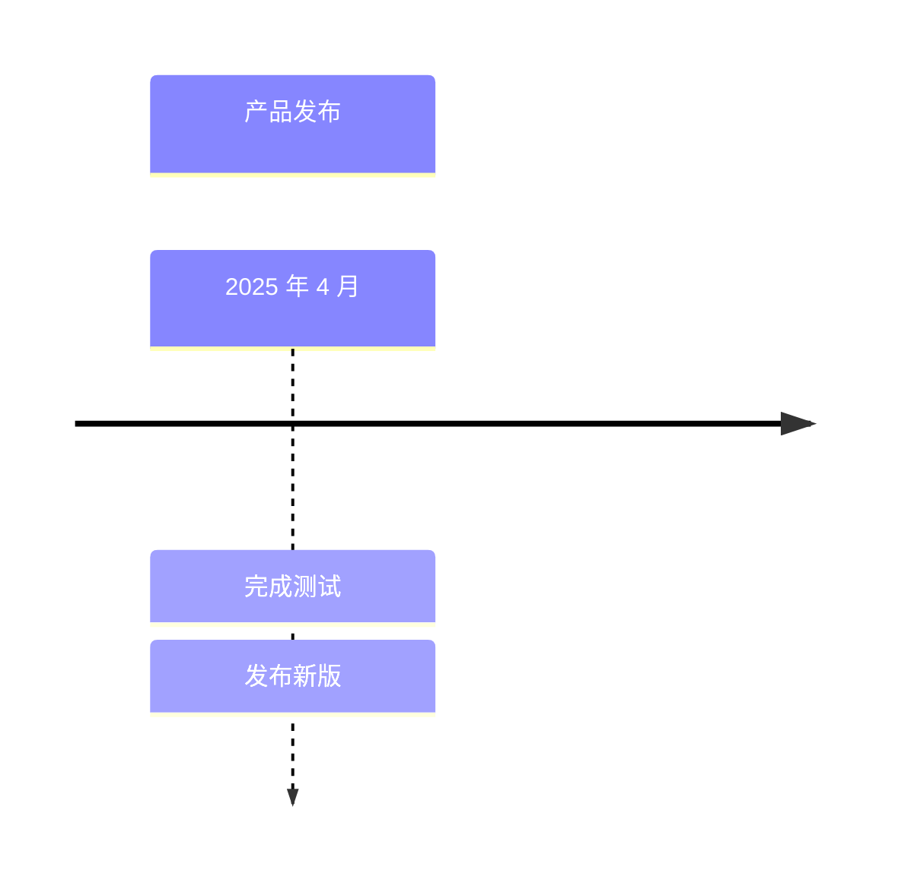
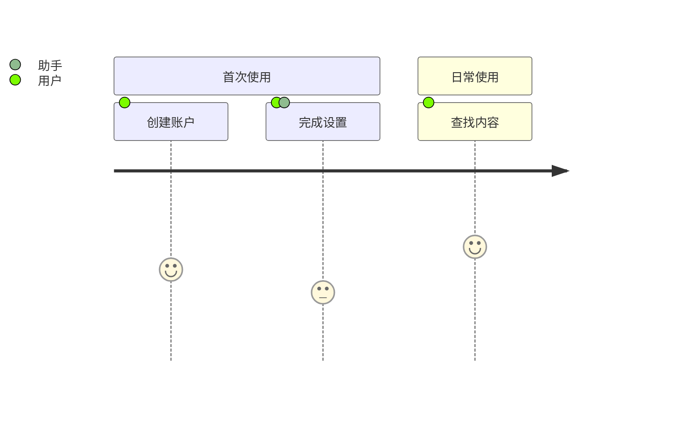
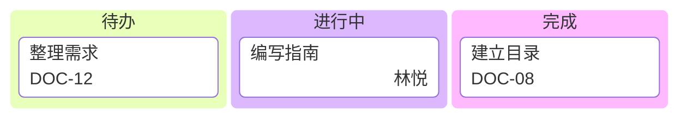
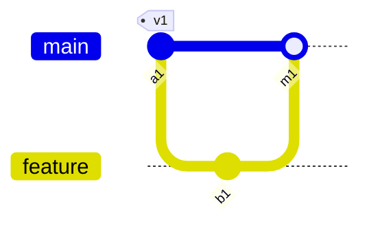

## flowchart

用 `flowchart LR` 或 `TD` 指定方向，节点形状由括号、方括号和花括号等定界符表达；连线可带 `|标签|`。`subgraph` 可将相关节点分组。



## sequenceDiagram

用 `participant` 或 `actor` 声明参与者，消息以 `->>`、`-->>` 等箭头表示。`alt`/`else`、`loop`、`break` 描述条件、循环和中断片段。



## zenuml

用 `标识 as 显示名` 声明参与者，在调用处写 `标识.方法()`。花括号内可以嵌套调用，也可以写 `if`/`else`、`while` 和 `return`。



## stateDiagram-v2

状态以 `A --> B : 触发条件` 描述迁移，`[*]` 表示起点或终点。可用 `state 名称 { ... }` 定义复合状态，`<<choice>>` 标记选择节点。



## swimlane-beta

用 `swimlane-beta LR` 或 `TB` 指定方向，并以 `subgraph id["泳道名"] ... end` 定义泳道。节点之间仍用流程图连线，因此可让流程跨泳道流转。

```mermaid
swimlane-beta LR
  subgraph sales["销售"]
    order[登记订单]
  end
  subgraph warehouse["仓库"]
    pack[打包]
  end
  order --> pack
```

## agentflow-beta

用 `agentflow-beta TB` 指定方向，`global ... end` 声明全局资源，`flow id["名称"] ... end` 定义流程范围。节点可用 `@{ shape: task }`、`decision` 或 `tool` 标记类型，箭头标签描述分支。

```mermaid
agentflow-beta TB
  global
    policy["操作规范"]@{ shape: refdoc }
  end
  flow review["审核"]
    check["检查内容"]@{ shape: task }
    decide["通过？"]@{ shape: decision }
    check --> decide
  end
```

## eventmodeling

用 `entity` 声明参与者，用 `tf 编号 类型 实体` 编排时间帧：`ui` 表示界面，`cmd` 表示命令，`evt` 表示已发生的事件。`->> 编号` 引用较早的帧；数据可紧跟在格式标记（如 `` `json` ``）后面。


## gantt

`dateFormat` 指定日期输入格式，`section` 将任务分组；每行任务可写开始日期与时长，或以 `after 任务ID` 排在依赖任务之后。任务状态可标为 `done`、`active`、`crit` 或 `milestone`。



## timeline

用 `section` 分组时间段，每个时间段以 `时间 : 事件` 开始；后续以 `: 事件` 开头的行会附加到同一时间段。也可省略分组，直接列出时间段。



## journey

`section` 划分旅程阶段，每项任务写作 `任务名称: 分数: 参与者`；参与者可用逗号分隔多个名称。分数用于表达任务体验评价。



## kanban

每个无缩进标题定义一个看板列，下面用缩进行定义卡片。卡片末尾可附 `@{key: value, ...}` 元数据，例如负责人、工单号或优先级。



## gitGraph

以 `gitGraph` 开始，可附 `LR`、`TB` 等方向；`commit` 记录提交，`branch`、`checkout` 切换分支，`merge` 合并分支。提交可带 `id`、`msg` 和 `tag`，也支持 `cherry-pick`。


